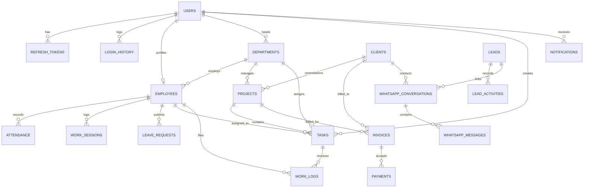

# Bodhiwaves Growth OS — Database Schema Specification

**Database Engine:** PostgreSQL 18.x  
**ORM:** SQLAlchemy 2.0  
**Migration Tool:** Alembic  
**Current Revision:** `2363164f64b1`

---

## 1. Entity-Relationship Overview

---

## 2. Table Specifications

### 2.1 Core Authentication & User Management

#### `users`
| Column | Type | Constraints | Description |
|---|---|---|---|
| `id` | `INTEGER` | PK, Index | Auto-increment primary key |
| `email` | `VARCHAR(255)` | Unique, Index, NOT NULL | Account email |
| `hashed_password` | `VARCHAR(255)` | NOT NULL | Bcrypt password hash |
| `full_name` | `VARCHAR(255)` | NOT NULL | User full name |
| `role` | `VARCHAR(50)` | Index, NOT NULL | `super_admin`, `admin`, `department_manager`, `team_leader`, `employee`, `client` |
| `phone` | `VARCHAR(50)` | Nullable | Contact number |
| `avatar_url` | `VARCHAR(500)` | Nullable | Avatar image URL |
| `avatar_initials` | `VARCHAR(10)` | Default `'BW'` | Two-letter initials |
| `is_active` | `BOOLEAN` | Default `TRUE` | Account active state |
| `is_verified` | `BOOLEAN` | Default `TRUE` | Email verification flag |
| `failed_login_attempts` | `INTEGER` | Default `0` | Lockout counter |
| `locked_until` | `TIMESTAMP WITH TIME ZONE` | Nullable | Temporary lockout expiration |
| `created_at` | `TIMESTAMP WITH TIME ZONE` | Default `now()` | Registration timestamp |
| `updated_at` | `TIMESTAMP WITH TIME ZONE` | Default `now()` | Last update timestamp |

#### `refresh_tokens`
| Column | Type | Constraints | Description |
|---|---|---|---|
| `id` | `INTEGER` | PK, Index | Primary key |
| `user_id` | `INTEGER` | FK $\rightarrow$ `users.id`, Index, NOT NULL | User identity |
| `token_hash` | `VARCHAR(255)` | Unique, Index, NOT NULL | SHA-256 hash of random token |
| `expires_at` | `TIMESTAMP WITH TIME ZONE` | NOT NULL | Expiry datetime (7 days) |
| `revoked` | `BOOLEAN` | Default `FALSE` | Rotation / revocation state |
| `user_agent` | `VARCHAR(500)` | Nullable | Browser user agent |
| `ip_address` | `VARCHAR(100)` | Nullable | Client IP address |
| `created_at` | `TIMESTAMP WITH TIME ZONE` | Default `now()` | Token issue timestamp |

#### `login_history`
| Column | Type | Constraints | Description |
|---|---|---|---|
| `id` | `INTEGER` | PK, Index | Primary key |
| `user_id` | `INTEGER` | FK $\rightarrow$ `users.id` (SET NULL), Nullable | User ID (if found) |
| `email` | `VARCHAR(255)` | Index, NOT NULL | Email entered at attempt |
| `ip_address` | `VARCHAR(100)` | Nullable | Request IP |
| `user_agent` | `VARCHAR(500)` | Nullable | Client device |
| `status` | `VARCHAR(50)` | NOT NULL | `success`, `failed`, `locked` |
| `failure_reason` | `VARCHAR(255)` | Nullable | Reason for failure |
| `created_at` | `TIMESTAMP WITH TIME ZONE` | Default `now()`, Index | Attempt timestamp |

---

### 2.2 HRMS, Departments & Transparent Tracking

#### `departments`
| Column | Type | Constraints | Description |
|---|---|---|---|
| `id` | `INTEGER` | PK, Index | Primary key |
| `name` | `VARCHAR(100)` | Unique, Index, NOT NULL | Department name |
| `code` | `VARCHAR(20)` | Unique, Index, NOT NULL | Short code (`SBD`, `DM`, `DEV`) |
| `description` | `TEXT` | Nullable | Department charter |
| `head_id` | `INTEGER` | FK $\rightarrow$ `users.id`, Nullable | Department head user |
| `is_active` | `BOOLEAN` | Default `TRUE` | Active flag |

#### `employees`
| Column | Type | Constraints | Description |
|---|---|---|---|
| `id` | `INTEGER` | PK, Index | Primary key |
| `user_id` | `INTEGER` | FK $\rightarrow$ `users.id`, Unique, Index, NOT NULL | Associated user account |
| `employee_code` | `VARCHAR(50)` | Unique, Index, NOT NULL | Employee badge ID |
| `department_id` | `INTEGER` | FK $\rightarrow$ `departments.id`, Index | Assigned department |
| `reporting_manager_id` | `INTEGER` | FK $\rightarrow$ `users.id`, Nullable | Reporting manager |
| `designation` | `VARCHAR(100)` | NOT NULL | Job title |
| `employment_status` | `VARCHAR(50)` | Default `'active'`, Index | `active`, `probation`, `notice`, `leave` |
| `live_status` | `VARCHAR(50)` | Default `'offline'`, Index | `online`, `working`, `break`, `away`, `offline` |
| `last_active_at` | `TIMESTAMP WITH TIME ZONE` | Nullable | WebSocket heartbeat timestamp |

#### `attendance` & `work_sessions`
- `attendance`: Date-based aggregate tracking check-in time, check-out time, total hours, and status (`present`, `half_day`, `late`, `absent`, `on_leave`).
- `work_sessions`: Real-time session intervals tracking start time, end time, session type (`working`, `break`), and duration.

---

### 2.3 Operations, Tasks, Projects & WhatsApp

- `tasks`: Core task lifecycle (`assigned` $\rightarrow$ `accepted` $\rightarrow$ `in_progress` $\rightarrow$ `under_review` $\rightarrow$ `completed`), with priority, deadline, checklist progress, and manager approval.
- `work_logs`: Employee work reports recording hours spent, work description, and submitted deliverables.
- `projects` & `clients`: Client directory and project delivery tracking.
- `leads` & `lead_activities`: Sales pipeline and CRM communication timeline.
- `whatsapp_accounts`, `whatsapp_conversations`, `whatsapp_messages`: Official Meta WhatsApp Cloud API conversations and message logs.
- `invoices`, `payments`, `expenses`: Financial tracking with balance calculations.
- `audit_logs`: Immutable security action log with user ID, action, entity, and IP address.
