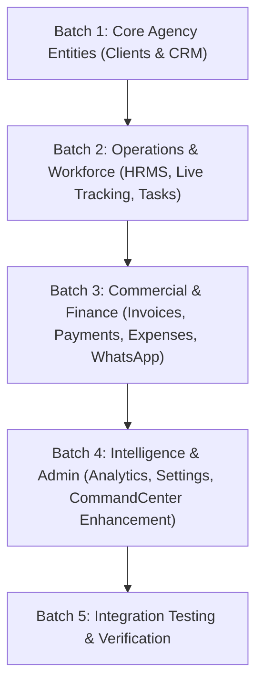

# Bodhiwaves Growth OS — Full ERP Functionality Audit

**Document:** `ERP_FUNCTIONALITY_AUDIT.md`  
**Application:** Bodhiwaves Growth OS (Commercial Agency ERP)  
**Database:** PostgreSQL 18.3 (`bodhiwaves_erp`) + MongoDB Atlas  
**Audit Timestamp:** 2026-11-01  
**Compliance Standard:** Commercial SaaS — No Fake Data Policy

---

## 1. Executive Summary

This technical audit reviews all 12 core modules of Bodhiwaves Growth OS across frontend routes, API routers, database models, schemas, permissions (RBAC), and user workflows. 

While PostgreSQL tables for all business entities are present and active in `bodhiwaves_erp`, several frontend routes currently render placeholder UI (`ModulePlaceholder`) rather than functional interactive interfaces. This audit establishes the exact gap analysis and provides the execution blueprint to bring the entire ERP to complete end-to-end operational functionality.

---

## 2. Module Classification Table

| # | Module | Classification | Backend Router | Database Tables | Frontend Route / Component |
|---|---|---|---|---|---|
| 1 | **Authentication & RBAC** | **Fully working** | `/api/v1/auth`, `/api/v1/users` | `users`, `refresh_tokens`, `login_history` | `/login`, `AuthContext.tsx`, `ProtectedRoute.tsx` |
| 2 | **Executive Dashboard** | **Partially working** | `/api/v1/departments`, `/api/v1/employees` | `departments`, `employees` | `/dashboard`, `CommandCenter.tsx` |
| 3 | **Departments** | **Partially working** | `/api/v1/departments` | `departments`, `users` | `/departments`, `DepartmentsView.tsx` |
| 4 | **Projects & Deliverables** | **Fully working** | `/api/v1/projects`, `/api/v1/tasks` | `projects`, `tasks`, `departments`, `clients` | `/projects`, `ProjectsView.tsx` |
| 5 | **Tasks & Sprints** | **API exists but frontend not connected** | `/api/v1/tasks` | `tasks`, `work_logs`, `employees`, `projects` | `/tasks`, `ModulePlaceholder` |
| 6 | **Clients Management** | **API missing, frontend placeholder** | *Missing* (`/api/v1/clients`) | `clients`, `users`, `projects` | `/clients`, `ModulePlaceholder` |
| 7 | **CRM & Sales Pipeline** | **API missing, frontend placeholder** | *Missing* (`/api/v1/crm`) | `leads`, `lead_activities`, `users` | `/crm`, `ModulePlaceholder` |
| 8 | **Workforce & HRMS** | **Partially working (API partial)** | `/api/v1/employees` (basic only) | `employees`, `attendance`, `leave_requests` | `/hrms`, `ModulePlaceholder` |
| 9 | **Live Workforce Tracking** | **Partially working (API partial)** | `/api/v1/employees/live-status` | `work_sessions`, `employees` | `/live-tracking`, `ModulePlaceholder` |
| 10 | **Finance & Invoices** | **API missing, frontend placeholder** | *Missing* (`/api/v1/finance`) | `invoices`, `payments`, `expenses` | `/finance`, `ModulePlaceholder` |
| 11 | **WhatsApp Business Inbox** | **API missing, frontend placeholder** | *Missing* (`/api/v1/whatsapp`) | `whatsapp_accounts`, `conversations`, `messages` | `/whatsapp`, `ModulePlaceholder` |
| 12 | **Analytics & Reports** | **API missing, frontend placeholder** | *Missing* (`/api/v1/analytics`) | Aggregates from all tables | `/analytics`, `ModulePlaceholder` |
| 13 | **Agency Settings & Audit** | **Partially working (API partial)** | `/api/v1/users`, `AuditService` | `users`, `audit_logs`, `login_history` | `/settings`, `ModulePlaceholder` |

---

## 3. Detailed Per-Module Technical Analysis

### 3.1 Authentication & RBAC
- **Status:** **Fully working**
- **Existing Backend:** `app/api/v1/auth.py`, `app/core/security.py`, `app/api/deps.py`. Supports bcrypt hashing, access token (JWT), refresh token rotation, login history tracking, account lockouts after failed attempts, and role hierarchy (`super_admin`, `admin`, `department_manager`, `team_leader`, `employee`, `client`).
- **Existing Frontend:** `LoginPage.tsx`, `AuthContext.tsx`, `ProtectedRoute.tsx`.
- **Database:** `users`, `refresh_tokens`, `login_history`.
- **Verdict:** Fully verified by automated pytest suite (9 tests passing).

### 3.2 Departments Module
- **Status:** **Partially working**
- **Existing Backend:** `app/api/v1/departments.py` provides list, get, create, update, delete with RBAC.
- **Existing Frontend:** `DepartmentsView.tsx` allows listing and creating departments.
- **Missing Operations:** Assigning department manager/head from user list; listing department staff members directly inside the department view.
- **Action Required:** Enhance backend to support head assignment and employee count breakdown; enhance frontend to show department manager and member drawer.

### 3.3 Projects & Deliverables Module
- **Status:** **Fully working**
- **Backend:** `app/api/v1/projects.py` provides complete CRUD, client linking, deadline, budget, department validation, and task recalculation.
- **Frontend:** `ProjectsView.tsx` connected to real PostgreSQL endpoints, search/filter, tasks & sprints drawer, manager approval workflow, honest empty state.
- **Verdict:** Fully verified end-to-end against PostgreSQL.

### 3.4 Tasks & Sprints Module
- **Status:** **API exists but frontend not connected**
- **Existing Backend:** `app/api/v1/tasks.py` provides full CRUD, status lifecycle, priority, hours tracking, manager approval, and parent project progress recalculation.
- **Existing Frontend:** `/tasks` route still renders `ModulePlaceholder`.
- **Action Required:** Build dedicated `TasksView.tsx` with sprint filters, priority tags, employee assignment, work log modal, and status transition controls.

### 3.5 Clients Management
- **Status:** **Not implemented (Backend router & Frontend view missing)**
- **Existing Database Model:** `Client` in `app/models/clients_projects.py` with `business_name`, `contact_person`, `email`, `phone`, `industry`, `status`, `account_manager_id`.
- **Action Required:**
  1. Build `backend/app/api/v1/clients.py` with full CRUD, search, filter, and linked projects.
  2. Build `frontend/src/components/clients/ClientsView.tsx` with add/edit client modal, contact cards, and active project counts.

### 3.6 CRM & Sales Pipeline
- **Status:** **Not implemented (Backend router & Frontend view missing)**
- **Existing Database Model:** `Lead` and `LeadActivity` in `app/models/crm.py` with stages (`new`, `contacted`, `qualified`, `proposal_sent`, `negotiation`, `won`, `lost`), deal values, follow-up dates, and activity logs.
- **Action Required:**
  1. Build `backend/app/api/v1/crm.py` with full CRUD for leads, stage progression endpoint, and activity logging.
  2. Build `frontend/src/components/crm/CrmView.tsx` with Kanban / List pipeline view, stage switcher, note logger, and "+ Create Lead" modal.

### 3.7 Workforce & HRMS
- **Status:** **Partially working (API partial, Frontend missing)**
- **Existing Database Model:** `Employee` in `app/models/employees.py`, `Attendance` and `LeaveRequest` in `app/models/attendance.py`.
- **Existing Backend:** `app/api/v1/employees.py` lists employees and creates profiles, but lacks attendance check-in/out and leave request processing.
- **Action Required:**
  1. Build `backend/app/api/v1/hrms.py` (or extend `employees.py`) to support:
     - Check-in / check-out with working hours calculation.
     - Leave applications and manager approval/rejection.
  2. Build `frontend/src/components/hrms/HrmsView.tsx` with employee roster, attendance logging tab, and leave approval queue.

### 3.8 Live Workforce Tracking
- **Status:** **Partially working (API partial, Frontend missing)**
- **Existing Database Model:** `WorkSession` in `app/models/attendance.py`.
- **Action Required:**
  1. Build `backend/app/api/v1/tracking.py` with session start/stop, heartbeat timer, and team presence overview.
  2. Build `frontend/src/components/tracking/LiveTrackingView.tsx` showing transparent team status (working, on break, idle) and active tasks.

### 3.9 Finance & Invoices
- **Status:** **Not implemented (Backend router & Frontend view missing)**
- **Existing Database Model:** `Invoice`, `Payment`, `Expense` in `app/models/finance.py`.
- **Action Required:**
  1. Build `backend/app/api/v1/finance.py` supporting invoice creation, payment recording, automated balance updates, and expense logging.
  2. Build `frontend/src/components/finance/FinanceView.tsx` with invoice generator, payment recorder, and expense tracker.

### 3.10 WhatsApp Business Inbox
- **Status:** **Not implemented (Backend router & Frontend view missing)**
- **Existing Database Model:** `WhatsAppAccount`, `WhatsAppConversation`, `WhatsAppMessage` in `app/models/whatsapp.py`.
- **Action Required:**
  1. Build `backend/app/api/v1/whatsapp.py` that verifies if Meta Cloud API credentials exist in environment. If missing, return an honest configuration status (`"configured": false`). If configured, handle conversations, messages, and webhooks.
  2. Build `frontend/src/components/whatsapp/WhatsAppView.tsx` displaying active conversations or an honest "Integration Not Configured" banner with clear setup guidance.

### 3.11 Analytics & Reports
- **Status:** **Not implemented (Backend router & Frontend view missing)**
- **Action Required:**
  1. Build `backend/app/api/v1/analytics.py` returning actual real-time aggregations from PostgreSQL:
     - Total revenue from paid invoices
     - Pipeline deal values
     - Active projects count and sprint completion rates
     - Department staff distribution
  2. Build `frontend/src/components/analytics/AnalyticsView.tsx` rendering charts from real database records.

### 3.12 Agency Settings & Audit
- **Status:** **Partially working (API partial, Frontend missing)**
- **Existing Backend:** `AuditService` logs events in `audit_logs` table.
- **Action Required:**
  1. Build `backend/app/api/v1/settings.py` for user profile updates, password change, audit log queries, and system configuration.
  2. Build `frontend/src/components/settings/SettingsView.tsx` with profile settings, audit trail viewer, and system status diagnostics.

---

## 4. Implementation Strategy & Dependency Order

To achieve a production-grade commercial ERP without breaking existing functionality, implementation proceeds in strictly ordered batches:

1. **Batch 1: Clients & CRM** (Clients are needed by Projects and Finance; Leads feed Clients).
2. **Batch 2: Operations & Workforce** (HRMS attendance/leaves, Live Tracking, Standalone Tasks & Sprints).
3. **Batch 3: Commercial & Finance** (Invoices linked to Clients & Projects, Payments, Expenses, WhatsApp Inbox).
4. **Batch 4: Intelligence & Administration** (Real Analytics from PostgreSQL, Agency Settings & Audit Logs, Executive Dashboard wiring).
5. **Batch 5: Comprehensive Verification** (Backend automated test suites, TypeScript builds, end-to-end CRUD verification).
