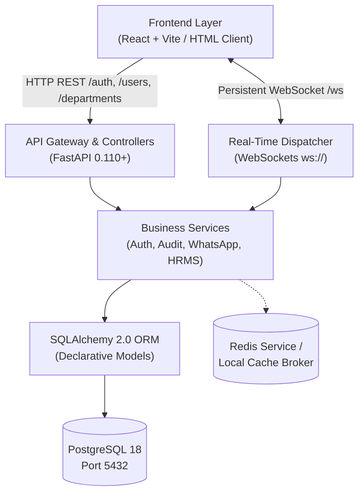

# Bodhiwaves Growth OS — System Architecture Specification

## 1. Architectural Vision & Core Principles

**Bodhiwaves Growth OS** is designed as a high-performance, modular Agency ERP platform tailored for Bodhiwaves Media. The architecture adheres to:
- **Separation of Concerns:** Distinct boundaries between data modeling, database sessions, business services, API controllers, and real-time event dispatchers.
- **Fail-Safe Local Development:** Full capability on localhost (PostgreSQL on port 5432, FastAPI on port 8000, Vite React on port 5173, HTML starter on port 5500) before any production deployment.
- **Stateless & Scalable Security:** Signed JWT access tokens with rotating refresh tokens stored securely in PostgreSQL.
- **Transparent Workforce Tracking:** Disclosed live status (`online`, `working`, `break`, `away`, `offline`), work sessions, and task logs via WebSockets without invasive surveillance.
- **Official Meta WhatsApp Cloud API Ready:** Standardized webhook receiver and outbound message dispatcher with simulated mock provider for offline local testing.

---

## 2. Tiered System Architecture



---

## 3. Component Breakdown

### 3.1 Backend Modular Layout (`backend/app/`)
```
backend/
├── app/
│   ├── main.py                  # FastAPI initialization, CORS, WebSocket endpoints
│   ├── core/
│   │   ├── config.py            # Pydantic BaseSettings, environment variables
│   │   ├── security.py          # Bcrypt hashing, JWT encoding/decoding, token rotation
│   │   └── permissions.py       # Enterprise RBAC hierarchy & role dependencies
│   ├── database/
│   │   ├── session.py           # Engine pool, SessionLocal, get_db generator
│   │   └── base.py              # DeclarativeBase class
│   ├── models/                  # SQLAlchemy 2.0 declarative database entities
│   │   ├── users.py             # User, RefreshToken, LoginHistory, PasswordResetToken
│   │   ├── departments.py       # Department
│   │   ├── employees.py         # Employee
│   │   ├── attendance.py        # Attendance, WorkSession, LeaveRequest
│   │   ├── tasks.py             # Task, WorkLog
│   │   ├── clients_projects.py  # Client, Project
│   │   ├── crm.py               # Lead, LeadActivity
│   │   ├── whatsapp.py          # WhatsAppAccount, WhatsAppConversation, WhatsAppMessage
│   │   ├── finance.py           # Invoice, Payment, Expense
│   │   └── audit.py             # AuditLog, Notification
│   ├── schemas/                 # Pydantic validation schemas
│   ├── api/v1/                  # REST controllers
│   │   ├── auth.py              # Login, token rotation, logout, password reset
│   │   ├── users.py             # User CRUD, role assignments, activation
│   │   ├── departments.py       # Department directory & management
│   │   ├── employees.py         # Employee profiles & transparent live status
│   │   └── health.py            # Health check & database ping
│   ├── services/
│   │   ├── auth_service.py      # Authentication, lockout, history, token rotation
│   │   ├── audit_service.py     # Immutable audit trail
│   │   └── whatsapp_service.py  # Official Meta Cloud API & mock integration
│   ├── websockets/
│   │   └── connection_manager.py# WebSocket client manager & broadcast channels
│   └── cli/
│       ├── bootstrap_admin.py   # Secure First-Admin bootstrap CLI
│       └── seed_departments.py # Seed 10 initial agency departments
├── alembic/                     # Alembic migration environment
├── tests/                       # Automated pytest integration test suite
├── requirements.txt
├── .env.example
├── .env
└── run_server.py
```

### 3.2 Role-Based Access Control (RBAC) Matrix

| User Role | Hierarchy Rank | Access Scope |
|---|---|---|
| **Super Admin** | 100 | Complete organization control, user provisioning, audit inspection, system settings |
| **Admin** | 80 | Operations management, employee assignment, finance, departments, full ERP CRUD |
| **Department Manager** | 60 | Department oversight, task approvals, team monitoring, work log reviews |
| **Team Leader** | 40 | Team task delegation, review requests, attendance tracking |
| **Employee** | 20 | Assigned tasks, work sessions, check-in/out, own deliverables and logs |
| **Client** | 10 | Client portal view: own projects, deliverables, approvals, invoices |

---

## 4. Real-Time WebSocket Infrastructure
- **Endpoint:** `ws://localhost:8000/ws` and `ws://localhost:8000/ws/{user_id}`
- **Protocol:** JSON message frames with client heartbeat (`ping` $\rightarrow$ `pong`).
- **Events:**
  - `EMPLOYEE_STATUS_CHANGED`: Dispatched whenever an employee updates their status (`online`, `working`, `break`, `away`, `offline`).
  - `NOTIFICATION_RECEIVED`: Dispatched when an alert is assigned to a specific user.
  - `TASK_STATUS_UPDATED`: Dispatched when task progress or manager approval changes.
